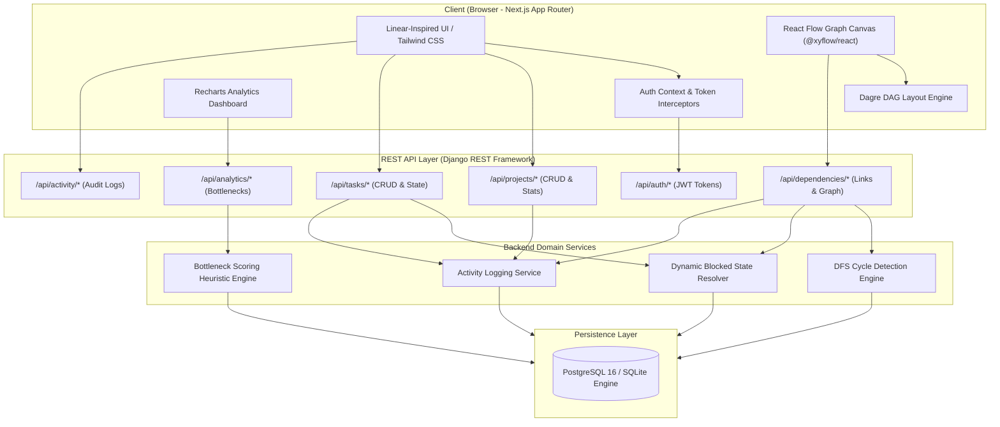
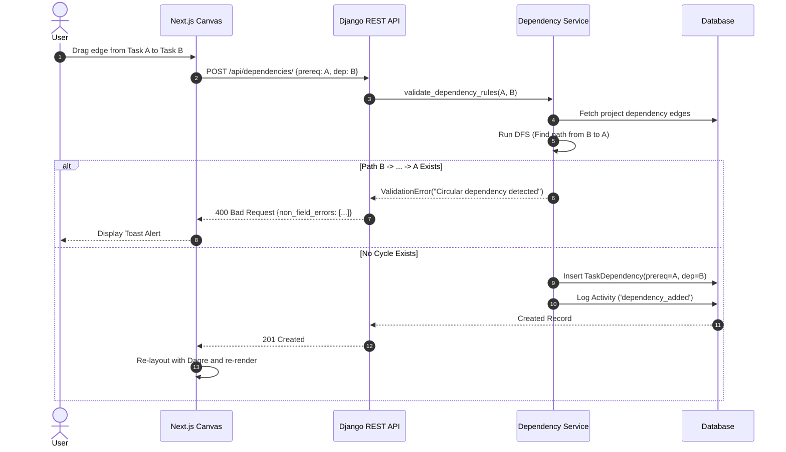

# FlowTrack — System Architecture

## 1. System Overview

**FlowTrack** is a full-stack personal workflow and task dependency management application. It models complex project schedules as **Directed Acyclic Graphs (DAGs)**:

\[
G = (V, E)
\]

where vertices \(V\) represent tasks and directed edges \(E\) represent dependency constraints (\(A \to B\) denotes that task \(B\) strictly depends on prerequisite task \(A\)).

The system is architected as two decoupled applications within a unified repository:
1. **Frontend**: Next.js 14 App Router, React 18, TypeScript, Tailwind CSS, `@xyflow/react` (React Flow), Dagre hierarchical graph auto-layout, and Recharts.
2. **Backend**: Python 3.10+, Django 5, Django REST Framework, and SimpleJWT for stateless token-based authentication.
3. **Database**: PostgreSQL (with automatic zero-config SQLite fallback for instant local execution and automated testing).

---

## 2. High-Level Architecture Diagram

---

## 3. Core Architectural Modules

### 3.1 Authentication & Multi-Tenant Isolation
- Authentication uses **Django REST Framework Simple JWT** with access and refresh tokens.
- **Tenant Isolation**: FlowTrack is designed as a single-user-per-account platform. All queries (`Project.objects.filter(owner=request.user)`) are strictly scoped to the authenticated user. Cross-user access returns HTTP 404/403.

### 3.2 Dependency Engine & Cycle Prevention
The dependency engine is encapsulated in a dedicated service module (`backend/dependencies/services.py`).

#### Depth-First Search (DFS) Cycle Detection Algorithm:
Before creating an edge \(A \to B\) (task \(B\) depends on task \(A\)):
1. FlowTrack searches for an existing directed path from \(B\) to \(A\):
   \[
   B \rightsquigarrow A
   \]
2. If \(B\) can reach \(A\) through existing dependency edges, adding \(A \to B\) creates a closed directed cycle:
   \[
   A \to B \rightsquigarrow A
   \]
3. The engine intercepts the cycle, extracts the cycle path, and returns HTTP 400 Bad Request explaining the exact conflicting loop.

### 3.3 Dynamic Blocked Task Resolution
A task is dynamically **blocked** if:
1. It is not completed (`status != 'completed'`).
2. At least one prerequisite task has not been completed.

Blocked state is never persisted as a static status; it is computed dynamically during query evaluation so that completing a prerequisite instantly unblocks dependent tasks across all graph queries.

### 3.4 Task Completion Eligibility Rule
FlowTrack enforces **Rule 5**: A task cannot transition to `status = 'completed'` if any of its upstream prerequisite tasks remain in `todo` or `in_progress`.

---

## 4. Analytics & Bottleneck Identification Engine

FlowTrack features a dependency-impact bottleneck scoring heuristic:
\[
\text{Bottleneck Score} = \text{Downstream Task Count} + 2 \times \text{Overdue Flag}
\]
where:
- \(\text{Downstream Task Count}\): Number of downstream tasks waiting on this task.
- \(\text{Overdue Flag}\): \(1\) if the task is incomplete and past its deadline, else \(0\).

> [!NOTE]
> This heuristic highlights near-term schedule risks and blockage cascades. It is clearly distinguished from formal Critical Path Method (CPM) duration float scheduling.
