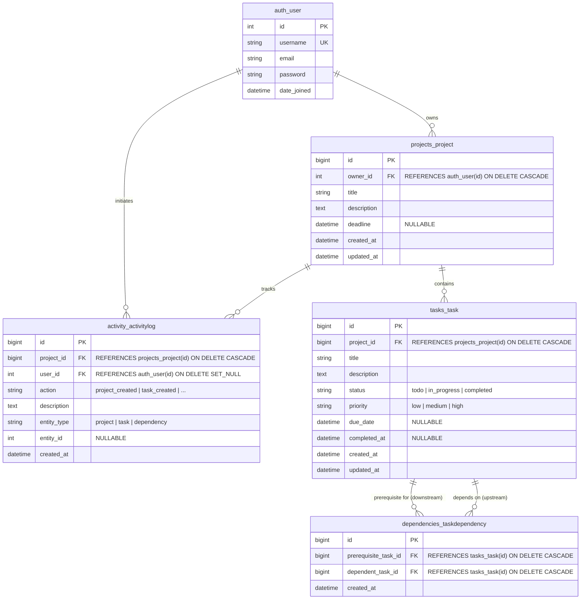

# FlowTrack — Database Schema & Data Modeling

## 1. Overview

FlowTrack uses a relational database schema designed for PostgreSQL and managed via the Django ORM. The schema models users, projects, tasks, dependency directed edges, and audit activity records with strict referential integrity, cascading rules, and query optimization indexes.

---

## 2. Entity Relationship Diagram (ERD)

---

## 3. Tables & Schema Specifications

### 3.1 `auth_user` (Django Built-in)
- **`id`**: `SERIAL PRIMARY KEY`
- **`username`**: `VARCHAR(150) UNIQUE NOT NULL`
- **`email`**: `VARCHAR(254)`
- **`password`**: `VARCHAR(128)` (Argon2 / PBKDF2 with SHA-256 hash)
- **`date_joined`**: `TIMESTAMP WITH TIME ZONE NOT NULL`

### 3.2 `projects_project`
Represents an individual user's project workspace.
- **`id`**: `BIGSERIAL PRIMARY KEY`
- **`owner_id`**: `INTEGER NOT NULL REFERENCES auth_user(id) ON DELETE CASCADE`
- **`title`**: `VARCHAR(255) NOT NULL`
- **`description`**: `TEXT DEFAULT ''`
- **`deadline`**: `TIMESTAMP WITH TIME ZONE NULL`
- **`created_at`**: `TIMESTAMP WITH TIME ZONE NOT NULL`
- **`updated_at`**: `TIMESTAMP WITH TIME ZONE NOT NULL`
- **Indexes**:
  - `INDEX (owner_id, created_at DESC)`: High performance index for listing owner's projects sorted chronologically.

### 3.3 `tasks_task`
Represents an actionable unit of work inside a project.
- **`id`**: `BIGSERIAL PRIMARY KEY`
- **`project_id`**: `BIGINT NOT NULL REFERENCES projects_project(id) ON DELETE CASCADE`
- **`title`**: `VARCHAR(255) NOT NULL`
- **`description`**: `TEXT DEFAULT ''`
- **`status`**: `VARCHAR(20) DEFAULT 'todo'` (Allowed: `todo`, `in_progress`, `completed`)
- **`priority`**: `VARCHAR(20) DEFAULT 'medium'` (Allowed: `low`, `medium`, `high`)
- **`due_date`**: `TIMESTAMP WITH TIME ZONE NULL`
- **`created_at`**: `TIMESTAMP WITH TIME ZONE NOT NULL`
- **`updated_at`**: `TIMESTAMP WITH TIME ZONE NOT NULL`
- **`completed_at`**: `TIMESTAMP WITH TIME ZONE NULL`
- **Indexes**:
  - `INDEX (project_id, status)`: Fast filtering by project task status.
  - `INDEX (project_id, due_date)`: Fast evaluation of overdue tasks.
  - `INDEX (project_id, priority)`: Fast priority filtering.
  - `INDEX (project_id, created_at DESC)`: Fast task listing ordered by creation.

### 3.4 `dependencies_taskdependency`
Represents a directed edge \(A \to B\) where task \(B\) depends on prerequisite task \(A\).
- **`id`**: `BIGSERIAL PRIMARY KEY`
- **`prerequisite_task_id`**: `BIGINT NOT NULL REFERENCES tasks_task(id) ON DELETE CASCADE`
- **`dependent_task_id`**: `BIGINT NOT NULL REFERENCES tasks_task(id) ON DELETE CASCADE`
- **`created_at`**: `TIMESTAMP WITH TIME ZONE NOT NULL`
- **Constraints**:
  - `UNIQUE (prerequisite_task_id, dependent_task_id)`: Prevents duplicate edges between the same pair of tasks.
- **Indexes**:
  - `INDEX (prerequisite_task_id, dependent_task_id)`
  - `INDEX (dependent_task_id)`: Enables instantaneous lookup of upstream prerequisites for blocked status calculation.

### 3.5 `activity_activitylog`
Audit history of actions taken on projects, tasks, and dependencies.
- **`id`**: `BIGSERIAL PRIMARY KEY`
- **`project_id`**: `BIGINT NOT NULL REFERENCES projects_project(id) ON DELETE CASCADE`
- **`user_id`**: `INTEGER NULL REFERENCES auth_user(id) ON DELETE SET_NULL`
- **`action`**: `VARCHAR(50) NOT NULL`
- **`description`**: `TEXT NOT NULL`
- **`entity_type`**: `VARCHAR(50) NOT NULL`
- **`entity_id`**: `INTEGER NULL`
- **`created_at`**: `TIMESTAMP WITH TIME ZONE NOT NULL`
- **Indexes**:
  - `INDEX (project_id, created_at DESC)`: Rapid retrieval of project audit streams.

---

## 4. Cascading & Referential Integrity Guarantees

1. **Project Deletion**:
   Deleting a project automatically cascades and deletes:
   - All tasks belonging to the project.
   - All dependency edges between tasks in the project.
   - All associated activity log records.
2. **Task Deletion**:
   Deleting a task automatically cascades and deletes:
   - Any dependency where the task is a prerequisite (`prerequisite_task_id`).
   - Any dependency where the task is a dependent (`dependent_task_id`).
